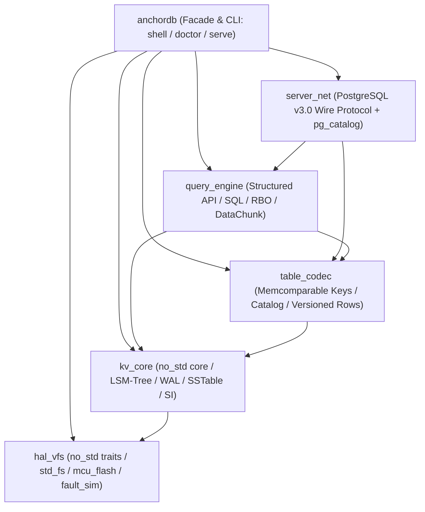

# AnchorDB

A modular, cross-platform, power-loss-safe database kernel written in Rust following the **"One Core, Multi-Form"** (*一核多态、按需加装*) philosophy.

- **`mode-mcu`** (`#![no_std]`): `hal_vfs` + `kv_core` for mid-to-high-end MCUs (≥ 256 KB RAM, primary target **ESP32-S3-N16R8** with 512 KB SRAM / 8 MB PSRAM / 16 MB Flash).
- **`mode-embedded`** (`std`): adds `table_codec` + `query_engine` (fluent structured API + embedded SQL + `DataChunk` executor) and CLI (`shell` / `doctor`) for desktop apps and games.
- **`mode-server`** (`std`): adds MVCC Snapshot Isolation + full SQL + `server_net` (PostgreSQL v3.0 wire protocol + `pg_catalog`/`information_schema` compatibility + `anchordb serve`) for `psql` / DBeaver / Navicat / `psycopg2` clients.

---

## Architecture & Module Decoupling

Dependencies are strictly unidirectional (acyclic DAG). Upper layers (`table_codec`, `query_engine`, `server_net`) program exclusively against abstract traits (`KvTransaction`, `SqlBackend`, `ServerSession`) and never reference concrete storage engines or filesystems (`LsmEngine`, `StdFileSystem`, `FaultSimFs`).



### Workspace Crates & Current Status

| Crate | Dependencies (Workspace) | Third-Party Deps | Status | Summary |
| :--- | :--- | :--- | :--- | :--- |
| `crates/hal_vfs` | *(none)* | **0** | ✅ Ready | `#![no_std]` `FileSystem`/`StorageFile`/`FileLock` traits, `std_fs` (OS lock + `sync_dir`), `mcu_flash` (ESP32-S3 NOR alignment checks), deterministic `fault_sim` power-loss VFS |
| `crates/kv_core` | `hal_vfs` | **0** | ✅ Ready | `#![no_std]` CRC32C & 64B Little-Endian Superblock, Commit-time `WriteBatch` WAL (tail torn-write truncation vs mid-file bit-rot rejection), atomic `Manifest`/`CURRENT`, SSTable, Compaction, Windows deferred reclamation, Snapshot Isolation (First-Committer-Wins), `inspect_database` |
| `crates/table_codec` | `kv_core` | **0** | ✅ Ready | Memcomparable order-preserving encoding (signed int, canonical f64, 8B chunked varlen, ASC/DESC), self-hosted System Catalog (`0x00`), zero-rewrite versioned rows (`schema_version` + `ColumnId`), unique & non-unique composite secondary indexes |
| `crates/query_engine` | `kv_core`, `table_codec` | `sqlparser` *(optional)* | ✅ Ready | Chainable structured query API (`col(...).gte(...)`), `DataChunk` columnar pull operators (`Filter`, `Projection`, `HashJoin`, `HashAggregate`, `Distinct`, `TopNSort`), PostgreSQL-dialect SQL parser/binder/RBO index selection, per-query memory budget |
| `crates/server_net` | `query_engine`, `table_codec` | **0** | ✅ Ready | Zero-dependency PostgreSQL Wire Protocol v3.0 TCP server (`Simple Query` + `Extended Query` Parse/Bind/Describe/Execute + optional password auth + `pg_catalog`/`information_schema` compatibility), default loopback bind `127.0.0.1:5432` |
| `crates/anchordb` | all *(optional by feature)* | *(via crates)* | ✅ Ready | Unified `AnchorDb` embedded facade, stateful `SqlSession`, interactive `anchordb shell`, `anchordb doctor`, and `anchordb serve` |

---

## Quick Start

### 1. Local Interactive SQL Shell & Integrity Doctor
```bash
# Launch interactive SQL shell on a local database directory
cargo run -p anchordb -- shell ./demo.db

# Run full on-disk CRC32C & Manifest/SSTable/WAL integrity inspection
cargo run -p anchordb -- doctor ./demo.db
```

### 2. PostgreSQL-Compatible Network Server (`mode-server`)
```bash
# Start PostgreSQL v3.0 server (binds loopback 127.0.0.1:5432 by default)
cargo run -p anchordb --features mode-server -- serve ./demo.db --listen 127.0.0.1:5432

# Windows one-click helper scripts (in scripts/)
scripts\start_server.bat
scripts\open_shell.bat
scripts\run_doctor.bat

# Optional password authentication
cargo run -p anchordb --features mode-server -- serve ./demo.db --listen 127.0.0.1:5432 --password secret

# Connect with psql, DBeaver, Navicat, or psycopg2
psql -h 127.0.0.1 -p 5432 -U postgres -d anchordb
```

Supported SQL:
- DDL: `CREATE TABLE`, `CREATE [UNIQUE] INDEX`, `ALTER TABLE ADD/DROP COLUMN`, `SHOW TABLES`
- DML: `INSERT INTO ... VALUES ...`, `UPDATE ... SET ... WHERE ...`, `DELETE FROM ... WHERE ...`
- Query: `SELECT [DISTINCT] ... FROM ... [INNER|LEFT JOIN ... ON ...] [WHERE ...] [GROUP BY ...] [HAVING ...] [ORDER BY ...] [LIMIT ...] [OFFSET ...]`, `EXPLAIN <SELECT ...>`
- Transactions: `BEGIN`, `COMMIT`, `ROLLBACK` (Snapshot Isolation; write conflicts return SQLSTATE `40001`)
- Client compatibility: `SET`/`SHOW`, `version()`, `current_schema()`, `current_database()`, `pg_catalog.{pg_namespace, pg_class, pg_attribute, pg_type}`, `information_schema.{tables, columns}`

### 3. Embedded Rust API (Desktop / Game Usage)
```rust
use anchordb::{AnchorDb, ColumnSpec, ColumnType, IndexSpec, SortOrder, Value, col};

let db = AnchorDb::open("./game_save.db")?;
db.create_table(
    "items",
    &[
        ColumnSpec { name: "id".into(), data_type: ColumnType::Int64, nullable: false, default_value: None },
        ColumnSpec { name: "rarity".into(), data_type: ColumnType::Int64, nullable: false, default_value: None },
        ColumnSpec { name: "level".into(), data_type: ColumnType::Int64, nullable: false, default_value: None },
    ],
    &["id"],
)?;
db.create_index("items", IndexSpec {
    name: "idx_rarity_level".into(),
    unique: false,
    columns: vec![("rarity".into(), SortOrder::Asc), ("level".into(), SortOrder::Desc)],
})?;

let top_items = db
    .table("items")
    .filter(col("rarity").gte(4))
    .order_by("level", SortOrder::Desc)
    .limit(20)
    .collect()?;
```

---

## Verification & Quality Gates

Workspace enforces `unsafe_code = "deny"`, `clippy::unwrap_used = "deny"`, and `clippy::expect_used = "deny"` (with test-only exemptions in `clippy.toml`).

```bash
# 1. Bare-metal #![no_std] verification (mode-mcu)
cargo check -p hal_vfs -p kv_core -p anchordb --no-default-features --features mode-mcu --target thumbv7em-none-eabihf

# 2. Feature matrix checks & tests
cargo check -p query_engine --no-default-features --features structured-api
cargo check -p query_engine --no-default-features --features sql
cargo test -p anchordb --no-default-features --features mode-embedded
cargo test -p anchordb --features mode-server
cargo test --workspace

# 3. Formatting & Clippy lints
cargo fmt --all -- --check
cargo clippy --workspace --all-targets -- -D warnings
```

Current test suite (**43 tests passing** across default & `mode-server`):
- **1000-seed deterministic power-loss crash recovery** (`crash_recovery_1000_random_seeds`): tests WAL write-budget cuts, torn writes, unsynced write drop/reorder, unsynced dir rollback, Flush/Manifest/Compaction, and Windows strict file-handle semantics.
- **Hermitage Snapshot Isolation suite** (`mvcc_hermitage.rs`): verifies G1a/G1b/P4 Lost Update prevention, PMP repeatable-read/phantom prevention, and 4-thread CAS retry consistency.
- **Relational & SQL regression suite** (`table_integration.rs`, `embedded_game_inventory.rs`, `sql_regression.rs`): verifies Memcomparable ordering, unique/composite DESC indexes, online schema evolution (add/drop/re-add), `IndexScan` vs `SeqScan` correctness oracle, JOINs, aggregates, explicit transactions, memory budgets, and `doctor`.
- **PostgreSQL Wire Protocol E2E suite** (`pgwire_server_e2e.rs`): verifies real TCP `SSLRequest` handshake, CleartextPassword auth (`28P01`), Simple & Extended (`Parse`/`Bind`/`Describe`/`Execute`) queries, `pg_catalog`/`information_schema` probes, and two-client concurrent write conflict returning SQLSTATE `40001`.

---

## Changelog

- **DBeaver / `pgjdbc` Extended Query Fix**: Enforced strict PostgreSQL v3.0 Extended Query framing (`RowDescription` emitted solely in `Describe('S'/'P')`, never duplicated in `Execute`), standardized `server_version` parameter status, and added `pg_database`/`pg_roles`/`pg_settings` virtual views.
- **Real Client Verification & Virtual `pg_catalog` Projection** (`24ad3e3`): Verified live TCP connectivity using Python `pg8000` (PostgreSQL v3 Extended Query protocol), upgraded `pg_catalog`/`information_schema` virtual views to execute full `DataChunk` projection/`WHERE`/`ORDER BY`/`LIMIT`.
- **Phase 3B (Milestone 3 Complete)** (`430ce72`): Implemented zero-dependency PostgreSQL Wire Protocol v3.0 server (`server_net`) with Simple + Extended Query, optional password auth, `pg_catalog`/`information_schema` compatibility layer, `anchordb serve` CLI, and real TCP E2E test suite.
- **Docs & Feature Hygiene** (`c0a5226`): Audited module decoupling, fixed `query_engine` `sql -> structured-api` feature dependency, and synced full architecture/usage docs to `README.md`.
- **Phase 3A** (`a652bc8`): Implemented columnar `DataChunk` pull-based operators (`Filter`, `Projection`, `HashJoin`, `HashAggregate`, `Distinct`, `TopNSort`), PostgreSQL-dialect SQL parser/binder/RBO index selection (`sqlparser 0.64`), stateful `SqlSession` (`BEGIN`/`COMMIT`/`ROLLBACK`), interactive `anchordb shell`, and SQL regression/oracle test suite.
- **Phase 2B** (`5eccf25`): Added Snapshot Isolation First-Committer-Wins write-conflict detection with bounded commit-history GC, Hermitage isolation test suite, `inspect_database` + `anchordb doctor <db_path>`, chainable `query_engine::api` with automatic index selection & memory budgets, and `AnchorDb` embedded facade.
- **Phase 2A** (`da9917c`): Implemented `table_codec` with Memcomparable order-preserving encoding, zero-rewrite versioned rows, self-hosted System Catalog with historical schema preservation, and transactional unique/non-unique composite secondary indexes.
- **Phase 1C** (`8f737bf`): Implemented `kv_core` LSM-Tree engine (`WriteBatch` WAL, atomic `Manifest`/`CURRENT`, binary-search SSTables, Compaction with Windows deferred reclamation) and 1000-seed deterministic crash recovery test suite.
- **Phase 1B** (`d650c3d`): Implemented `hal_vfs` (`std_fs` with OS locks & `sync_dir`, `#![no_std]` `mcu_flash` geometry checks for ESP32-S3-N16R8, and deterministic `fault_sim` power-loss VFS) and unified LF line endings via `.gitattributes`.
- **Phase 1A** (`920e08a`): Bootstrapped Cargo Workspace skeleton, `rust-toolchain.toml`, `clippy.toml`, RFC 0001, `#![no_std]` CRC32C & 64B SuperblockHeader, and GitHub Actions CI.
